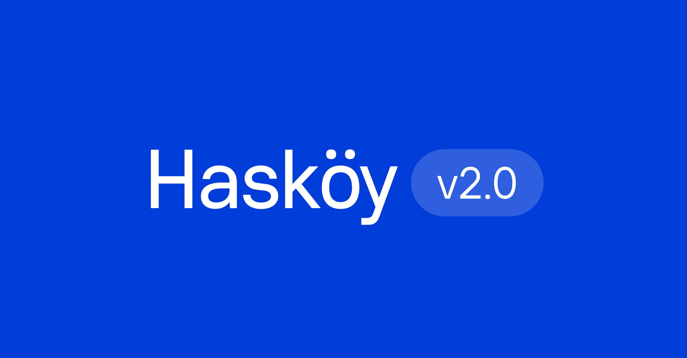

# Hasköy

[](https://haskoy.ertekinn.com/)

Hasköy is an open-source variable sans-serif typeface family. Designed with powerful opentype features and each weight includes latin-extended language support, stylistic alternates, fractions, tabular figures, arrows and more. Currently, the family includes Latin Vietnamese, Pinyin, and all Western, Central, and South-Eastern European language support.

All weights, styles and opentype features of the Hasköy family can be tested on [haskoy.ertekinn.com](https://haskoy.ertekinn.com/)


## Building the Fonts

The source is `source/haskoy.glyphs` (Glyphs 3). The fonts are built with [gftools builder](https://github.com/googlefonts/gftools), the same toolchain Google Fonts uses.

The italics are slanted versions of the upright masters. `source/prepare_sources.py` creates the upright and italic designspaces from the `.glyphs` file, using the Rename Glyphs, Decompose Glyphs and Transformations parameters of the "Italic" instance. To change the italic, edit those parameters in Glyphs.

Build and test with `make` (Python 3.10–3.12; the first run sets up a virtual environment from `requirements.txt`):

```
make build   # builds everything into fonts/
make test    # runs fontbakery (Google Fonts profile), reports in out/fontbakery/
make proof   # HTML proofs in out/proof/
make clean   # removes the virtual environment and build intermediates
```

Output goes to `fonts/`:

- `fonts/variable`: `Haskoy[wght].ttf` and `Haskoy-Italic[wght].ttf`
- `fonts/ttf`: static TTFs
- `fonts/otf`: static OTFs
- `fonts/webfonts`: WOFF2

Every push to `main` and every pull request is built and tested on GitHub Actions. The fonts and Font Bakery reports are attached to each run as the `fonts-and-reports` artifact.

## License

Hasköy is licensed under the SIL Open Font License v1.1, see [OFL.txt](OFL.txt) for details.
